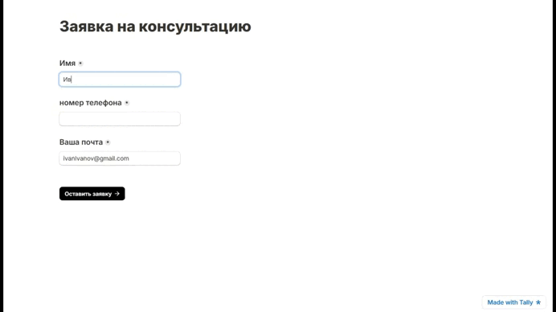
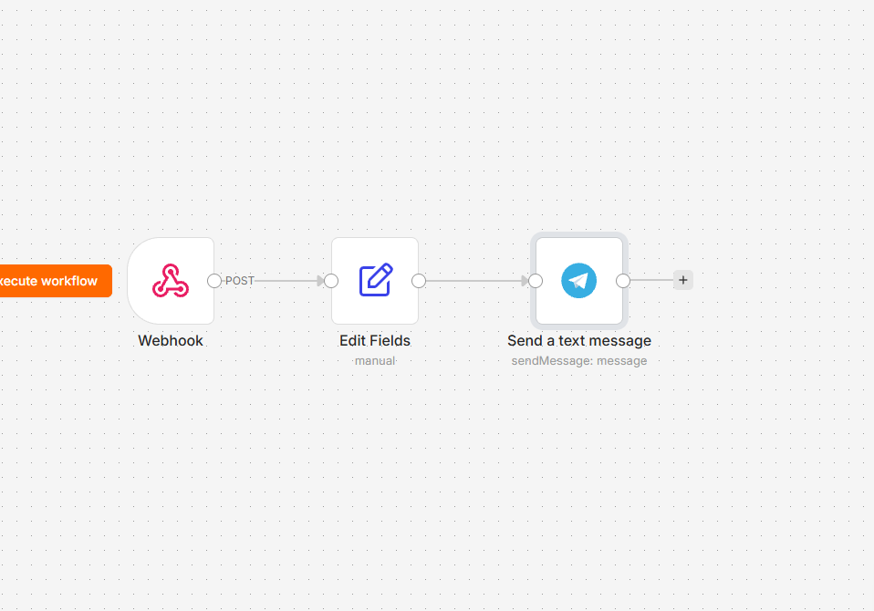

# 📥 Авто-сборщик лидов из веб-форм в Telegram

Сценарий автоматизации для платформы n8n, обеспечивающий мгновенный прием заявок из онлайн-форм (например, Tally) и их структурированную доставку в рабочий Telegram-чат команды. Решение исключает ручной мониторинг входящих писем и таблиц, сокращая время первого контакта менеджера с потенциальным клиентом до долей секунды.



## 🚀 Ключевые возможности

* **Прием данных в реальном времени:** обработка входящих HTTP POST-запросов через легковесный Webhook.
* **Безопасный парсинг массива полей:** точечное извлечение значений по ключам формы (`question_*`) с защитой от сбоев через оператор опциональной последовательности `?.`
* **Строгая типизация данных:** нормализация полей имени, контактного номера телефона и email в строковый формат.
* **Готовая HTML-разметка уведомлений:** форматирование текста заявки с выделением ключевой информации и моноширинным тегом `<code>` для быстрого копирования почты в один клик.

## 🏗 Архитектура и стек

* **Tally Forms** — веб-интерфейс захвата контактов на сайте.
* **n8n** (self-hosted / cloud) — маршрутизация, трансформация и обработка полезной нагрузки.
* **Telegram Bot API** — доставка структурированного сообщения менеджеру или в рабочую группу.



```text
+-----------------------+
|  Форма на сайте       |
|  (Tally Forms)        |
+-----------+-----------+
            |
            | HTTP POST (Webhook)
            v
+-----------------------+
|  n8n: Webhook         |
|  path: webhook-leads  |
+-----------+-----------+
            |
            | body.data.fields
            v
+-----------------------+
|  n8n: Edit Fields     |  <-- Извлечение Имени, Телефона, Почты
+-----------+-----------+
            |
            | $json (HTML payload)
            v
+-----------------------+
|  n8n: Telegram Node   |
|  Send a text message  |
+-----------+-----------+
            |
            | Telegram API
            v
+-----------------------+
|  Telegram-чат         |
|  команды / менеджеров |
+-----------------------+
```

## 🛠 Быстрый старт и установка

### Предварительные требования

1. Развернутый экземпляр n8n.
2. Аккаунт в Telegram, зарегистрированный бот через `@BotFather` и полученный токен доступа API.
3. ID чата или группы (`chatId`), куда бот будет присылать лиды.
4. Форма с настроенной отправкой вебхука (например, в Tally).

### Пошаговый запуск

[Скачайте готовый JSON-шаблон](lead_ingestion_template.md)

1. **Импорт сценария:**
   * Скопируйте JSON-код сценария или импортируйте файл воркфлоу в интерфейс n8n.
2. **Настройка Webhook:**
   * Откройте узел `Webhook` и скопируйте production-URL.
   * Вставьте полученный URL в раздел отправки вебхуков вашей формы.
3. **Сопоставление полей (Edit Fields):**
   * Откройте узел `Edit Fields`.
   * Замените идентификаторы `question_2bJMKb`, `question_x0PeJ9`, `question_ZGzp2v` на актуальные ключи полей вашей формы:
     * `Имя`: `{{ $json.body.data.fields.find(f => f.key === 'ВАШ_KEY_ИМЕНИ')?.value }}`
     * `Номер Телефона`: `{{ $json.body.data.fields.find(f => f.key === 'ВАШ_KEY_ТЕЛЕФОНА')?.value }}`
     * `почта`: `{{ $json.body.data.fields.find(f => f.key === 'ВАШ_KEY_ПОЧТЫ')?.value }}`
4. **Настройка Telegram:**
   * В узле `Send a text message` укажите сохраненные Credentials вашего Telegram-бота.
   * В параметре `Chat ID` замените плейсхолдер `YOUR_TELEGRAM_CHAT_ID` на фактический идентификатор целевого чата.
5. **Активация:**
   * Переведите переключатель воркфлоу в статус `Active`.

## 🛡 Обработка краевых случаев (Edge Cases)

| Сценарий | Поведение системы | Результат |
| :--- | :--- | :--- |
| **Отсутствие опционального поля** | Оператор безопасного поиска `?.value` в узле `Edit Fields` возвращает пустое значение[cite: 6]. | Сценарий не падает с ошибкой, сообщение отправляется в чат без сбоя выполнения. |
| **Отправка специальных символов** | В узле Telegram включен параметр `parse_mode: HTML`. | Корректное отображение разметки без сломанного синтаксиса сообщений. |
| **Невалидный `chatId`** | Telegram Bot API отклоняет запрос с ошибкой авторизации чата. | n8n фиксирует ошибку в журнале Execution Log с указанием статуса доставки. |

## 📊 Метрики эффективности

| Параметр | Значение | Примечание |
| :--- | :--- | :--- |
| **Время отклика системы** | < 1 сек | Отправка вебхука из формы и мгновенный пуш в Telegram|
| **Затраты на API** | $0 | Бесплатный тариф вебхуков формы + прямой Telegram Bot API|
| **Потребление ресурсов** | Минимальное | Использование легковесных нативных узлов n8n без обращения к LLM |

## 📬 Контакты

* **Автор:** Kodzhi Tanaka
* **Telegram:** [@TanakaKodzhi](https://t.me/TanakaKodzhi)
* **Канал с шаблонами и автоматизациями:** [Build -> Запуск](https://t.me/tanaka_dev)
